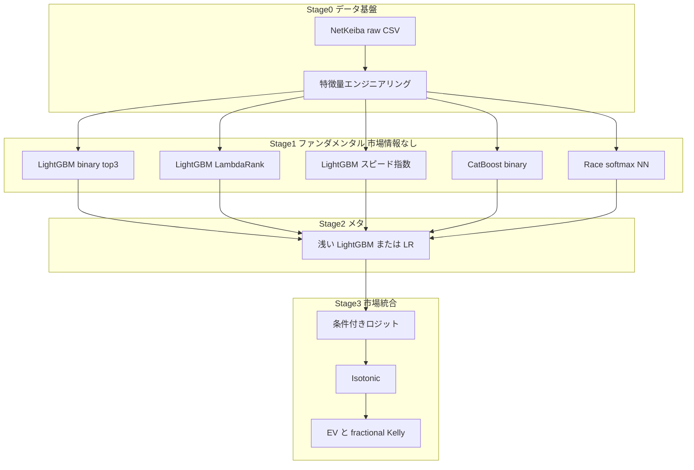

# keiba-predict

芝レースの **勝率 / 3着以内確率** を推定し、市場オッズと統合して **ROI** を評価するプロジェクトです。

市場情報は Stage1 の特徴量には入れず、Stage3 でベンチマークとして結合します。

## 概要

| 項目 | 内容 |
|------|------|
| 最終目的 | 単勝の期待値・ROI（控除率を超えるか） |
| 中間タスク | 単勝確率（レース内 softmax）と 3着以内確率 |
| Stage1 | 市場情報なしの全特徴: LightGBM binary / LambdaRank / スピード指数回帰、CatBoost binary、レース単位 Transformer |
| Stage2 | レース内正規化メタ（浅い LightGBM または LR） |
| Stage3 | longshot 補正 + 条件付きロジット + Isotonic + EV 閾値 + fractional Kelly |
| 対象レース | 芝（近走にはダート・障害を残す） |
| 検証 | 年単位 walk-forward（ベース / メタ / キャリブレーション / ROI テスト） |

## アーキテクチャ



特徴量の除外列（着順・走破時間などレース後情報、学習時のオッズ）は [`train/column_select.py`](train/column_select.py) を参照してください。

## ディレクトリ構成

```
keiba-predict/
├── datasets/
│   ├── data_process.py      # 前処理・スピード指数・相対特徴・expanding 集計
│   ├── raw_data/            # {year}.csv と任意の {year}_payouts.csv
│   └── encoded/             # encoded_all.csv / train / test / preprocess_meta.pkl
├── train/
│   ├── train_pipeline.py    # ROI パイプライン（本番）
│   ├── base_models.py       # Stage1 GBDT
│   ├── race_nn.py           # Stage1-E レース NN
│   ├── meta_model.py        # Stage2
│   ├── market_roi.py        # Stage3
│   ├── walk_forward.py      # 年単位分割
│   ├── train_utils.py       # リークなし ES・時系列 split
│   └── metrics.py
├── model/roi/               # walk-forward 成果物
└── requirements.txt
```

## セットアップ

```bash
python -m venv .venv
source .venv/bin/activate
pip install -r requirements.txt
```

Python 3.10+ 推奨。主要な依存: pandas, scikit-learn, lightgbm, catboost, torch, scipy。

## 使い方

すべての学習・推論コマンドは **リポジトリルート** から実行してください。

### 1. 生データの配置

`datasets/raw_data/` に `{year}.csv`（SHIFT-JIS）を配置してください。
払戻金がある場合は `{year}_payouts.csv`（scraper が出力）も同じディレクトリへ。

### 2. データ前処理

```bash
python datasets/data_process.py
```

- 全馬場を読み、近走を作ったあとに芝へ絞る
- スピード指数は距離 × 場id × 馬場の z-score（train 期間だけで fit）
- 頭数、レース内相対特徴、リークなし expanding 成績を付与
- `encoded_all.csv` / `encoded_traindata.csv` / `encoded_testdata.csv` を出力

`--year-start` / `--year-end` / `--train-year-end` で対象年を変更できます。

### 3. ROI パイプライン

```bash
python train/train_pipeline.py --train --predict
python train/train_pipeline.py --train --predict --skip-nn          # NN なし
python train/train_pipeline.py --train --predict --max-windows 1    # 直近1ウィンドウ
```

既定の walk-forward は 6年ベース + 3年メタ + 1年キャリブレーション + 1年 ROI テストを1年ずつスライドします。

- 比較表: `./model/roi/walk_forward_metrics.csv`（ROI とブートストラップ区間、AUC 等）
- 各ウィンドウ: `./model/roi/test_YYYY/`（予測、ベット明細、モデル）

## 評価指標

- 意思決定: 単勝 ROI（ブートストラップ 5–95%）、ベット数、的中率
- 診断: AUC、logloss、Brier、precision@3 / recall@3、1着的中率
- Stage3 の `w_model` が大きいほど、ファンダメンタルが市場に上乗せしている

## 注意事項

- 生データ CSV はリポジトリに含まれません
- Stage1 は現レースのオッズ・人気を使いません。オッズは Stage3 の市場確率にだけ使います
- 走破時間・上がり・通過順・今走スピード指数はリークになるため特徴から除外します
- ROI がプラスになることは保証しません。控除率 20〜25% を超えるかは `w_model` と walk-forward ROI で判断してください

## ライセンス

未設定
