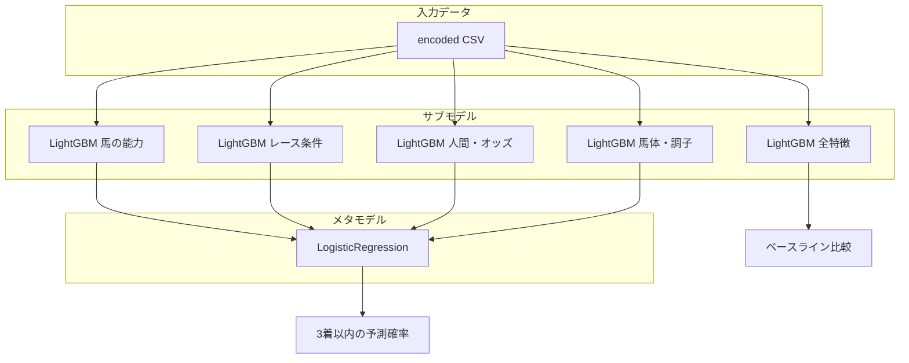

# keiba-predict

機械学習で **3着以内に入る確率** を予測するプロジェクトです。4観点の LightGBM を OOF スタッキングし、全特徴 LightGBM をベースラインとして比較します。

## 概要

| 項目 | 内容 |
|------|------|
| 予測タスク | 2値分類（3着以内 = 1、4着以下 = 0） |
| 使用アルゴリズム | LightGBM（4観点 + 全特徴ベースライン）、スタッキング（OOF 確率 + Logistic Regression） |
| 対象レース | 芝レース（データ前処理時にフィルタ） |
| 学習データ | 2011〜2023年（約31万行） |
| テストデータ | 2024年（約1万行） |

## アーキテクチャ

4つの観点ごとに LightGBM を学習し、時系列 CV の OOF 確率をロジスティック回帰で結合します。同じ特徴に CatBoost を重ねず、全特徴 LightGBM をベースラインとして比較します。



### サブモデルの特徴量グループ

| モデル | 観点 | 主な特徴量 |
|--------|------|-----------|
| `horse_ability` | 馬の能力 | 性・齢、過去3走の着順・クラス・上がり、平均斤量、日付差 |
| `race_condition` | レース条件適性 | 芝/ダ、距離、回り、馬場、天気、場、距離差、過去の条件 |
| `human_bias` | 人間・オッズ | 騎手、オッズ、人気、馬番、騎手勝率、過去のオッズ・騎手 |
| `horse_condition` | 馬体・調子 | 体重・体重変化、過去3走の通過順 |

特徴量の定義は [`train/column_select.py`](train/column_select.py) を参照してください。

## ディレクトリ構成

```
keiba-predict/
├── datasets/
│   ├── data_process.py      # 生データの前処理・特徴量エンジニアリング
│   ├── raw_data/            # 生データ CSV（ローカル配置、Git 非管理）
│   └── encoded/             # 前処理済み CSV と preprocess_meta.pkl
├── train/
│   ├── column_select.py     # 特徴量グループ定義
│   ├── train_utils.py       # 時系列 CV・LightGBM 学習
│   ├── metrics.py           # 馬単位・レース単位の評価
│   ├── stacking_model.py    # スタッキングメタモデル
│   └── predict_with_stacking.py  # 推論スクリプト
├── train_exam/              # 初期実験用スクリプト（TabNet, XGBoost 等）
├── model/
│   ├── lightgbm/            # 学習済み LightGBM モデル
│   └── stacking/            # メタモデル・予測結果
└── requirements.txt
```

## セットアップ

```bash
# Python 3.10+ 推奨
python -m venv .venv
source .venv/bin/activate

pip install -r requirements.txt
```

主要な依存パッケージ: pandas, scikit-learn, lightgbm。`train_exam/` を動かす場合は catboost, xgboost, pytorch-tabnet, torch も使います。

## 使い方

すべての学習・推論コマンドは **リポジトリルート** から実行してください。

### 1. 生データの配置

`datasets/raw_data/` に `{year}.csv`（SHIFT-JIS）を配置してください。
このディレクトリは Git 管理外です。

### 2. データ前処理

```bash
python datasets/data_process.py
```

`data_process.py` では以下を行います:

- 2011〜2024 年をまとめて処理し、近走特徴が年をまたげるようにする
- 走破時間の標準化パラメータは train（year <= 2023）だけで推定
- 日付は 2010-01-01 からの日数
- 騎手勝率は当該レースより前の成績のみ
- カテゴリ encoders は train で fit（未知カテゴリは専用コード）
- `encoded_traindata.csv` と `encoded_testdata.csv` を同時に出力

`--year-start` / `--year-end` / `--train-year-end` で対象年を変更できます。

### 3. スタッキング学習・評価

観点モデルの OOF 学習、ロジスティックメタ、全特徴ベースライン、2024 テスト評価を一括で行います。

```bash
python train/stacking_model.py --train --predict
python train/stacking_model.py --train --predict --ablation   # オッズ・人気あり/なし
python train/stacking_model.py --train --predict --no-odds     # 市場情報なしのみ
```

- メタモデル: `./model/stacking/meta_model.pkl`
- 比較表: `./model/stacking/comparison.csv`（AUC, logloss, Brier, レース単位 precision@3 / recall@3, 1着的中）
- 予測結果: `./model/stacking/predictions.csv`

### 4. 任意データへの推論

```bash
python train/predict_with_stacking.py \
  --input ./datasets/encoded/encoded_testdata.csv \
  --output ./model/stacking/predictions.csv
```

オッズなしモデルを使う場合は `--no-odds` を付けます。

入力 CSV は `encoded_traindata.csv` と同じカラム構成である必要があります。

## データパイプライン詳細

```
raw_data/{year}.csv        # ローカル配置、SHIFT-JIS
    ↓ data_process.py
encoded/encoded_*.csv      # ラベルエンコード済み、近5走特徴量付き
    ↓ train/stacking_model.py
model/lightgbm/*.pkl
    ↓
model/stacking/meta_model.pkl
    ↓ predict
model/stacking/predictions.csv
```

### 生データのカラム

race_id, 馬, 騎手, 馬番, 走破時間, オッズ, 通過順, 着順, 体重, 体重変化, 性, 齢, 斤量, 上がり, 人気, レース名, 日付, 開催, クラス, 芝・ダート, 距離, 回り, 馬場, 天気, 場id, 場名

## 評価指標

- 馬単位: AUC、logloss、Brier score
- レース単位: 予測上位3頭の precision@3 / recall@3、予測1位の1着的中率
- 閾値 0.5 の混同行列には依存しない

## 注意事項

- 生データ CSV はリポジトリに含まれません。`datasets/raw_data/` をローカルで用意してください
- ベースモデルはレース単位の時系列 CV で OOF 予測し、メタモデルはその OOF だけで学習します
- 推論時に使用する特徴量（オッズ・人気・走破時間等）は、実際の馬券購入タイミングで利用可能かどうかを確認してください
- `train_exam/` は TabNet・XGBoost など初期実験用のスクリプトで、本番パイプラインとは独立しています

## ライセンス

未設定
